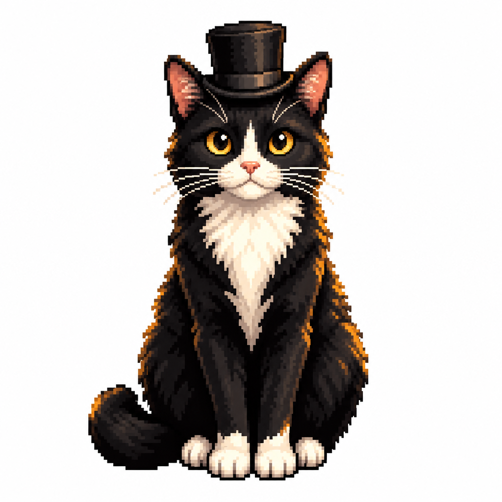
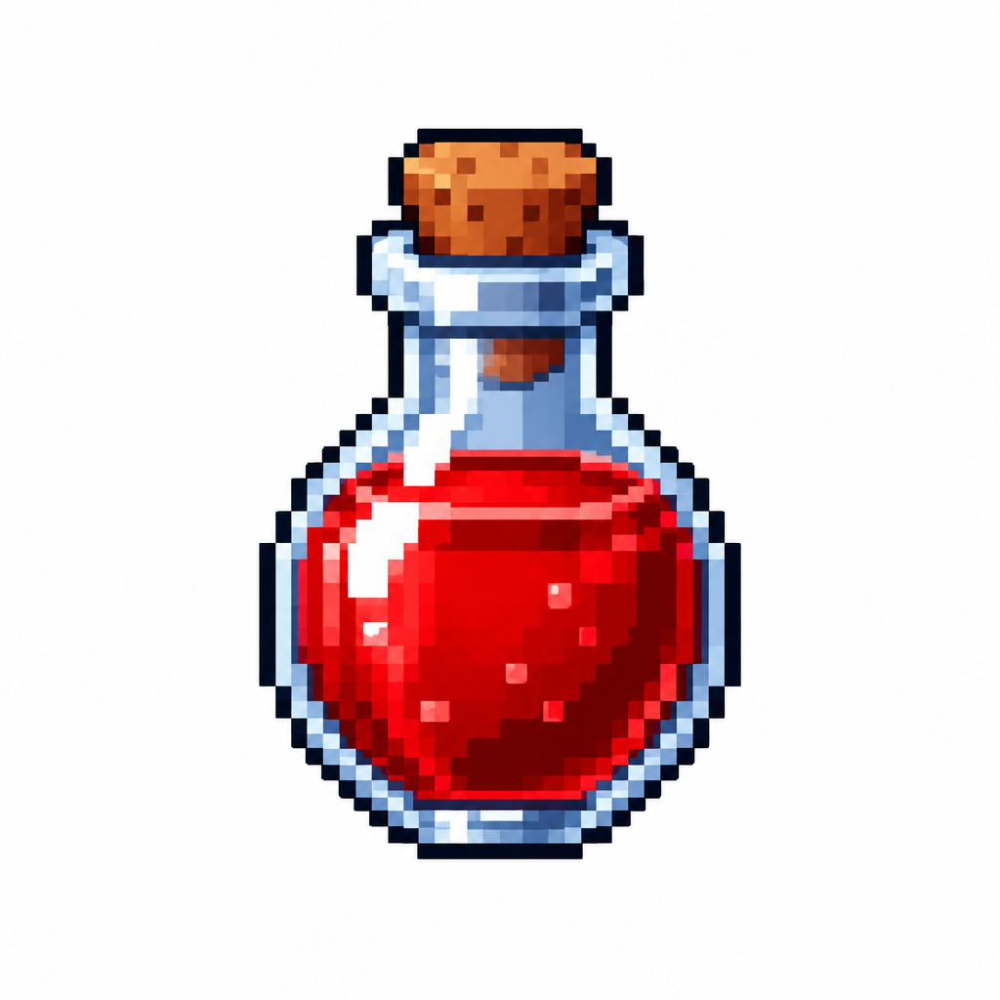
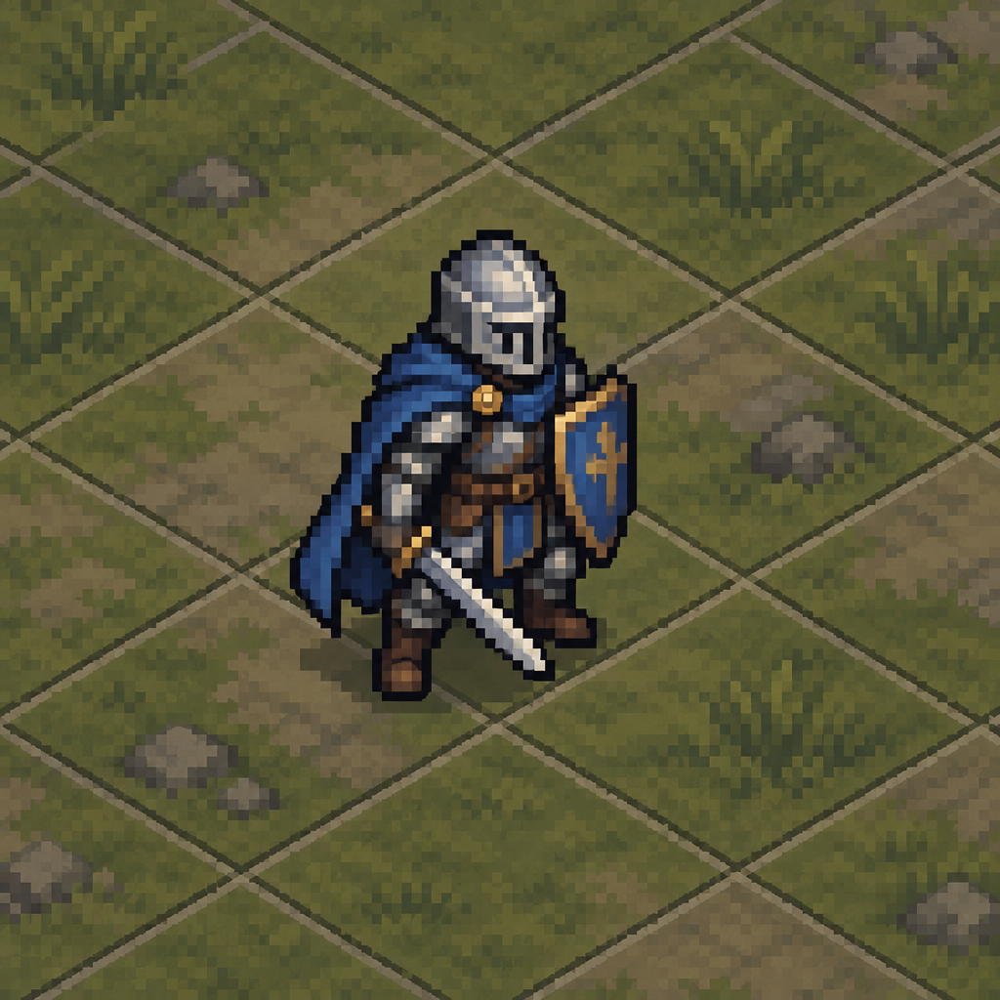
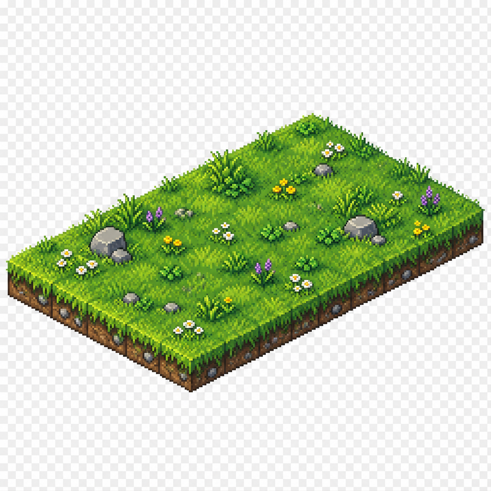
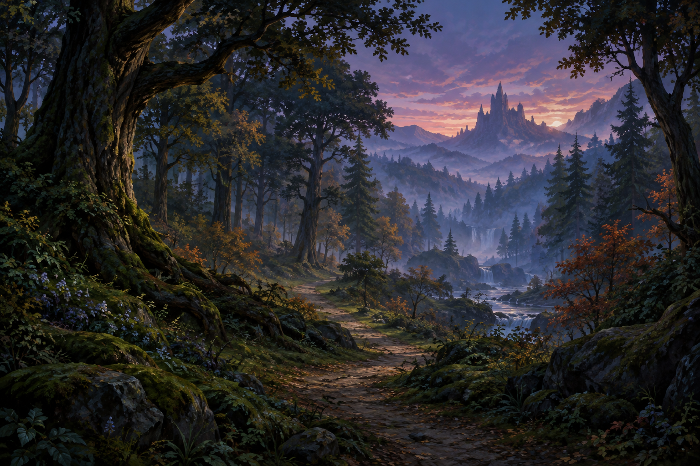
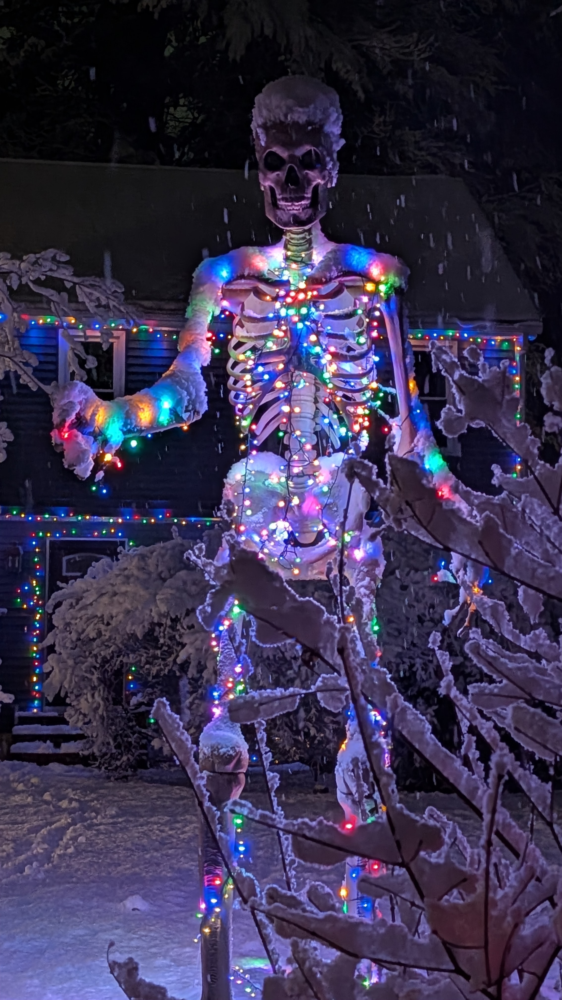
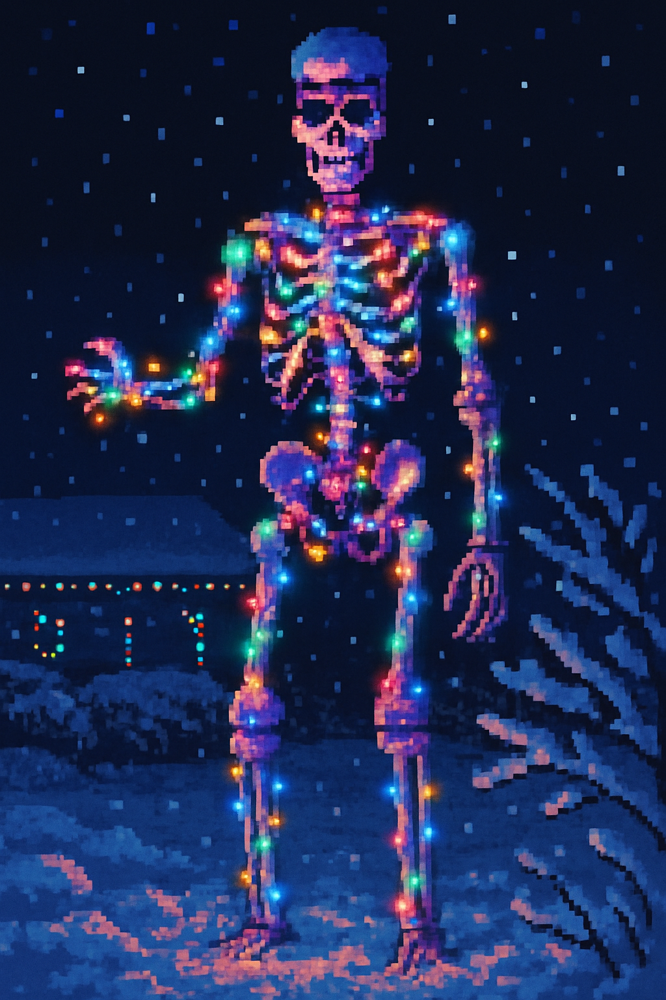

# imagegen2

Generate and edit game-oriented image assets from Codex, Claude Code, Gemini,
or a terminal using OpenAI GPT Image 2.5.

`imagegen2` is based on `github.com/zeveck/imagegen`, updated for GPT Image 2.x
and packaged as self-contained Agent Skills for multiple coding agents. Use it
for sprites, tiles, item icons, UI elements, portraits, backgrounds, concept
art, and reference-image variants.

## What's New in v2026.10.11

- Defaults to OpenAI GPT Image 2.5 Flare: about 3x faster and 4x cheaper than
  `gpt-image-2` at the same quality setting.
- `--background transparent` now uses native model alpha, with clean soft edges
  on fire, smoke, glow, and fur.
- New `xhigh`/`max` quality, `gpt-image-2.5-sunburst` for detailed finals, and
  `IMAGEGEN2_MODEL` to pin a project's model.

See the [changelog](CHANGELOG.md) for behavior changes and the
[upgrade notes](docs/migration-from-imagegen.md#upgrading-from-imagegen2-010-gpt-image-2-to-v20261011).

## Choosing a Skill

These sibling skills are complementary. The benchmark prompts below are shared
where practical so you can compare outputs without pretending the APIs are
identical.

| Skill | Back end | Good fit | Tradeoffs |
|-------|----------|----------|-----------|
| [`imagegen`](https://github.com/zeveck/imagegen) | OpenAI `gpt-image-1` | Classic game assets, direct transparent PNG/WebP sprites and icons | Older OpenAI image model, legacy size set |
| `imagegen2` | OpenAI GPT Image 2.5 (`gpt-image-2.5-flare` default) | Current OpenAI image path, flexible sizes up to 4K-class outputs, high-fidelity edits, native transparency with soft edges | `xhigh`/`max` quality is slow |
| [`nanogen`](https://github.com/zeveck/nanogen) | Google Gemini / Nano Banana image models | Rich style catalog, natural-language edits, multi-image composition, multi-turn refinement | No native alpha output; often returns JPEG and uses chromakey/post-processing for transparent-style assets |

## Requirements

- Node.js 20.12+.
- An OpenAI API key with GPT Image model access.
- API Organization Verification may be required before GPT Image models work.

Create a project `.env` file:

```bash
cp .env.example .env
```

Set `OPENAI_API_KEY` in `.env`. Optionally set `OPENAI_ORGANIZATION` and
`OPENAI_PROJECT` if your key needs explicit routing.

If a live call returns a verification error, verify the organization in the
OpenAI platform settings. If the organization was just verified and the error
persists, create a new API key for that verified organization/project.

## Benchmark Gallery

These outputs use the prompts in [examples/prompts.md](examples/prompts.md).
The set is intentionally broad enough to reuse across `imagegen`, `imagegen2`,
and `nanogen` for apples-to-apples comparison.

| Sprite | Item icon | Tactical unit |
|:------:|:---------:|:-------------:|
|  |  |  |

| Terrain tile | UI icon | Background |
|:------------:|:-------:|:----------:|
|  |  |  |

Reference-image edit, using the same input photo as `/imagegen`:

| Input photo | `/imagegen` (`gpt-image-1`) | `imagegen2` (`gpt-image-2`) |
|:-----------:|:---------------------------:|:---------------------------:|
|  |  |  |

## Install

### Claude Code

Install imagegen2 as a Claude Code plugin (Claude Code 2.1.275 or later):

```text
/plugin install imagegen2 --marketplace zeveck/imagegen2
```

Or in two steps, which also works on older versions:

```text
/plugin marketplace add zeveck/imagegen2
/plugin install imagegen2@imagegen2
```

The skill is then available as `/imagegen2` (or `/imagegen2:imagegen2`).
Update to a new release with:

```bash
claude plugin marketplace update imagegen2
claude plugin update imagegen2@imagegen2
```

then run `/reload-plugins` in any open session. The installed version is shown
by `claude plugin list` and reported as `imagegen2Version` in every CLI result.

Without the plugin system, copy `skills/imagegen2` into a project's
`.claude/skills/` or your user skills directory. Copies don't update; re-copy
to upgrade.

### Codex

Ask Codex to install the Codex skill folder:

```text
$skill-installer install https://github.com/zeveck/imagegen2/tree/main/.codex/skills/imagegen2
```

Restart Codex after installing so the skill index refreshes. You can also copy
`.codex/skills/imagegen2` into your Codex skills location. The installed skill
runs its bundled `generate.cjs`.

### Gemini

Install the Gemini skill folder:

```bash
gemini skills install https://github.com/zeveck/imagegen2/tree/main/.gemini/skills/imagegen2
```

Or link it while developing:

```bash
gemini skills link .gemini/skills/imagegen2 --scope workspace
```

Run `/skills reload` in Gemini CLI if it does not appear immediately.
If your Gemini CLI version does not accept GitHub tree URLs, clone this repo
and run the `gemini skills link` command against the local
`.gemini/skills/imagegen2` directory.

### Repository Layout

The repository ships one canonical CLI for development plus self-contained
skill folders for each agent. The skill folders duplicate the tiny
zero-dependency CLI so each works when installed on its own.

```text
cli/generate.cjs                   # canonical CLI
cli/reference.md                   # canonical style/prompt reference
.claude-plugin/plugin.json         # Claude Code plugin manifest
.claude-plugin/marketplace.json    # single-plugin marketplace
skills/imagegen2/                  # Claude Code skill (plugin skill)
.codex/skills/imagegen2/           # Codex skill
.gemini/skills/imagegen2/          # Gemini skill
```

After editing `cli/generate.cjs` or `cli/reference.md`, run `npm run sync` to
copy them into the skill folders; `npm test` fails if they drift. When
developing the Claude skill in this repo, load it with
`claude --plugin-dir .`.

## CLI

```bash
node cli/generate.cjs \
  --prompt "A 32-bit pixel art cat wearing a top hat, centered, blank background, no text" \
  --output "./generated-images/cat-tophat.png" \
  --quality low \
  --size 1024x1024
```

Migrating from `imagegen`? See
[docs/migration-from-imagegen.md](docs/migration-from-imagegen.md).

Dry-run without an API key:

```bash
node cli/generate.cjs \
  --dry-run \
  --prompt "A pixel art sword" \
  --output "./assets/items/sword.png" \
  --size 2048x1152
```

## Reference Images

Use `--image` to edit or style-match an existing image. Multiple references are
supported.

```bash
node cli/generate.cjs \
  --prompt "Create a potion bottle icon matching the style of these item icons" \
  --output "./assets/items/potion.png" \
  --image "./assets/items/sword.png" \
  --image "./assets/items/shield.png" \
  --quality low
```

Use `--mask` with a PNG alpha mask for regional edits. The API requires the mask
to match the input image's format and size and to include an alpha channel.

## Models

| Model | Use it for |
|-------|------------|
| `gpt-image-2.5-flare` (default) | Almost everything: fast, native transparency, `xhigh`/`max` quality |
| `gpt-image-2.5-sunburst` | Slower, more detailed final art at the same token price |
| `gpt-image-2` | Matching assets made before the 2.5 upgrade (no native transparency) |

The default follows OpenAI's latest Flare snapshot. To keep a whole project on
one exact model, set `IMAGEGEN2_MODEL` in the project's `.env`, for example
`IMAGEGEN2_MODEL=gpt-image-2.5-flare-2026-09-08`.
`IMAGEGEN2_MODEL=latest` (or leaving it unset) tracks the default.
`--model` still overrides it for a single command; `--model latest` uses the
default even in a pinned project.

In a 2026-10-09 comparison at `medium` quality, Flare was about 3x faster and
4x cheaper per image than `gpt-image-2`, and held character identity across
reference-image edits at least as well.

## Sizes

GPT Image 2.x models accept `auto` or flexible `WxH` sizes when they satisfy the
documented constraints:

- each edge is `<= 3840`
- each edge is a multiple of `16`
- long-edge to short-edge ratio is `<= 3:1`
- total pixels are between `655360` and `8294400`

Common sizes:

- `1024x1024`
- `1536x1024`
- `1024x1536`
- `2048x2048`
- `2048x1152`
- `3840x2160`
- `2160x3840`
- `auto`

Outputs larger than `2560x1440` total pixels are still experimental in the
OpenAI docs. Use 4K sizes intentionally.

## Transparent Backgrounds

`--background transparent` uses the model's native alpha channel on GPT Image
2.5. No other flag is needed:

```bash
node cli/generate.cjs \
  --prompt "A red dragon breathing fire, 16-bit RPG sprite, isolated on a transparent background, no shadows, no ground" \
  --output "./assets/dragon.png" \
  --background transparent \
  --quality medium
```

Native alpha handles soft edges such as fire, smoke, glow, and fur cleanly. The
CLI applies a light local cleanup to native-alpha PNGs: alpha >= 240 snaps to
255 (the model leaves solid subjects at about 252), alpha <= 2 snaps to 0, and
fully transparent pixels take nearby edge colors so resizing doesn't pull in
the hidden backdrop. Pass `--no-alpha-cleanup` to keep raw model alpha.

`--transparent-mode` picks how transparency is produced:

- `auto` (default): native alpha when the model supports it, otherwise an
  error naming the alternatives.
- `native-alpha`: require the model's own alpha channel.
- `chroma-key`: request an opaque solid key-color background from `--model`,
  then remove that key color locally from PNG output. Produces hard binary
  alpha. Use it for pipelines built around it, or with `gpt-image-2`, which has
  no native alpha.
- `fallback-model`: legacy native alpha via `gpt-image-1.5`.
- `reject`: refuse transparent output.

```bash
node cli/generate.cjs \
  --prompt "A cute 16-bit RPG kitten sprite, centered, no text" \
  --output "./assets/kitten.png" \
  --background transparent \
  --transparent-mode chroma-key \
  --chroma-key '#ff00ff' \
  --quality low
```

Chroma-key mode normalizes the API request to `background: "opaque"` and adds
prompt guidance for a solid flat key background. Models often paint the key a
little off (for example `#ee04e4` for `#ff00ff`), so when the image corners are
dominated by a color near the requested key, cleanup keys on that detected
color and reports it as `postprocess.detectedKey`. Cleanup fails rather than
writing a mostly opaque image if 3 or more of the 4 corners stay opaque. The local
cleanup alpha-bleeds hidden RGB in fully transparent pixels from nearby visible
pixels and can suppress strongly key-colored visible edge pixels when clean
nearby subject colors are available. This conservative edge cleanup preserves
alpha and silhouette; it is not full matting or global color decontamination,
so glow and smoke keep a key-colored fringe. Use key colors absent from the
subject, commonly `#ff00ff` or `#00ff00`. Agents should disclose that this is
local chroma-key cleanup rather than native model alpha.

JPEG cannot be used for transparent output.

## Common Options

```text
--prompt <string>
--output <path>
--size <auto|WxH>
--quality <low|medium|high|xhigh|max|auto>   # xhigh/max: GPT Image 2.5 only
--background <auto|opaque|transparent>
--transparent-mode <auto|native-alpha|chroma-key|fallback-model|reject>
--no-alpha-cleanup               # keep raw native alpha
--chroma-key <#rrggbb>            # chroma-key mode only, default #00ff00
--chroma-tolerance <0-442>        # chroma-key RGB distance, default 24
--output-compression <0-100>     # JPEG/WebP only
--image <path>                   # repeatable, max 16
--mask <png-path>
--model <id|latest>              # default $IMAGEGEN2_MODEL, else latest (gpt-image-2.5-flare)
--timeout <seconds>              # per attempt; default 300, 600 for xhigh/max
--client-request-id <id>
--dry-run
```

Run `node cli/generate.cjs --help` for the complete option list, including
history controls.

`--input-fidelity` is intentionally unsupported: GPT Image 2.x models reject it,
and image inputs are processed at high fidelity automatically.

## History

Successful calls append to `.imagegen2-history.jsonl` with prompt, output path,
parameters, request IDs, token usage, and any reference images.

## Tests

Offline validation does not call OpenAI:

```bash
npm test
```

Full local validation:

```bash
npm run test:all
```

Live smoke tests are opt-in:

```bash
IMAGEGEN2_LIVE_TEST=1 npm run test:all
```

## Docs Checked

Model, size, quality, transparency, and input-fidelity behavior are based on the
current
[OpenAI Image generation guide](https://developers.openai.com/api/docs/guides/image-generation)
and the
[GPT-Image-2.5 Flare](https://developers.openai.com/api/docs/models/gpt-image-2.5-flare)
and
[GPT-Image-2.5 Sunburst](https://developers.openai.com/api/docs/models/gpt-image-2.5-sunburst)
model pages.

Live probes on 2026-10-09 confirmed that both GPT Image 2.5 models return real
alpha for `background: "transparent"` and reject `input_fidelity` with HTTP 400.
`gpt-image-2` returned HTTP 400 for native transparency when probed on
2026-05-03.
